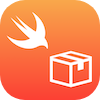
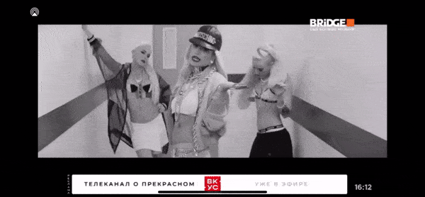

# AVPlayerKit

AVPlayerKit — набор расширений и UI-компонентов для построения медиаплееров на базе `AVFoundation`. Пакет упрощает работу с `AVPlayer`, предоставляет готовые представления управления воспроизведением и инструменты для интеграции с системным `Now Playing` и `MPRemoteCommandCenter`.

## Возможности
- **Расширения AVFoundation**. Удобные инициализаторы и вспомогательные методы для `AVPlayer`, `AVPlayerItem` и `AVAsset`.
- **Контроллер плеера**. `PlayerViewController` объединяет `PlayerView`, `PlayerStatusView` и `PlayerControlsView` для быстрого создания интерфейса воспроизведения.
- **Статусы и задержки**. `PlayerStatusView` выводит состояние плеера, а `PlayerStallsObserver` отслеживает буферизацию.
- **Валидация ресурсов**. `AVAssetValidator` последовательно проверяет коллекцию потоков и сообщает об изменении их состояний.
- **Now Playing**. `NowPlayingInfoBuilder` подготавливает словарь для `MPNowPlayingInfoCenter`.
- **Дистанционное управление**. `RemoteCommandCenter` регистрирует действия в `MPRemoteCommandCenter`.

## Установка



### Swift Package Manager

Добавьте зависимость в `Package.swift` проекта:

```swift
dependencies: [
    .package(url: "https://github.com/<your-org>/AVPlayerKit.git", branch: "main")
]
```

и подключите продукт `AVPlayerKit` к целевой сборке:

```swift
.target(
    name: "YourApp",
    dependencies: [
        .product(name: "AVPlayerKit", package: "AVPlayerKit")
    ]
)
```

## Быстрый старт

```swift
import AVPlayerKit

// Создаём контроллер плеера и привязываем к нему плеер с медиапотоком.
let playerViewController = PlayerViewController()
playerViewController.playerView.player = AVPlayer(urlString: "https://example.com/video.mp4")
playerViewController.playerView.player?.play()

// Добавляем контроллер плеера в текущую иерархию `UIViewController`.
addChild(playerViewController)
view.addSubview(playerViewController.view)
// Размер и положение представления плеера задаёт макет приложения.
playerViewController.didMove(toParent: self)
```

`AVPlayer(urlString:)` вернёт `nil`, если передан некорректный URL.

`PlayerViewController` автоматически отслеживает состояние `AVPlayer`, отображает ошибки и анимацию буферизации.

## Наблюдение за состоянием плеера

Свойства `playerView`, `player` и `playerItem` поддерживают KVO-наблюдение через property wrapper `@ObservedNSObject` — синтаксический сахар над стандартным методом [observe(_:options:changeHandler:)](https://developer.apple.com/documentation/swift/using-key-value-observing-in-swift):

```swift
let playerViewController = PlayerViewController()

// Наблюдаем за изменением плеера.
playerViewController.$player.addObserver(self, keyPath: \.timeControlStatus) { player, _ in
    switch player.timeControlStatus {
    case .playing:
        print("Воспроизведение")
    case .paused:
        print("Пауза")
    case .waitingToPlayAtSpecifiedRate:
        print("Буферизация")
    @unknown default:
        break
    }
}

// Наблюдаем за изменением текущего элемента воспроизведения.
playerViewController.$playerItem.addObserver(self, keyPath: \.status) { playerItem, _ in
    if playerItem.status == .readyToPlay {
        print("Готов к воспроизведению")
    }
}
```

Удаляем наблюдение за конкретным свойством:

```swift
playerViewController.$player.removeObserver(self, keyPath: \.timeControlStatus)
```

Все наблюдения владельца, например в `deinit` контроллера:

```swift
deinit {
    playerViewController.$player.removeObserver(self)
    playerViewController.$playerItem.removeObserver(self)
}
```


## AirPlay



```swift
import AVPlayerKit

let playerViewController = PlayerViewController()
playerViewController.enableAirPlay()
```

`AVRoutePickerView` автоматически отображает список доступных маршрутов воспроизведения.

## Картинка в картинке (Picture-in-Picture)

```swift
import AVPlayerKit

let playerViewController = PlayerViewController()
playerViewController.enablePictureInPicture()
```

Для обработки событий PiP реализуйте протокол `AVPictureInPictureControllerEventDelegate`:

```swift
// Установка делегата
playerViewController.setPictureInPictureControllerEventDelegate(self)

extension YourViewController: AVPictureInPictureControllerEventDelegate {
    func pictureInPictureController(
        _ pictureInPictureController: AVPictureInPictureController,
        event: AVPictureInPictureController.Event
    ) {
        switch event {
        case .willStart:
            print("PiP начинает запуск")
        case .didStart:
            print("PiP запущен")
        case .failedToStart(let error):
            print("Ошибка запуска PiP: \(error)")
        case .willStop:
            print("PiP начинает завершение")
        case .didStop:
            print("PiP завершён")
        }
    }
}
```

> **Примечание:** Для работы PiP необходимо включить capability **Background Modes → Audio, AirPlay, and Picture in Picture** в настройках таргета.

### Использование AVPictureInPictureControllerDelegateProxy

`AVPictureInPictureControllerDelegateProxy` — прокси-класс для обработки событий `AVPictureInPictureControllerDelegate` с поддержкой множественных подписчиков. Позволяет нескольким объектам получать события PiP без необходимости передавать делегат напрямую.

```swift
import AVKit
import AVPlayerKit

let pipController = AVPictureInPictureController(playerLayer: playerLayer)
let delegateProxy = AVPictureInPictureControllerDelegateProxy()

// Устанавливаем прокси как делегат контроллера PiP
pipController?.delegate = delegateProxy

// Добавляем подписчиков на события
delegateProxy.setDelegate(self)
delegateProxy.setDelegate(analyticsHandler)

// Для восстановления UI после выхода из PiP устанавливаем dataSource
delegateProxy.dataSource = self
```

Реализуйте `AVPictureInPictureControllerDataSource` для восстановления интерфейса:

```swift
extension YourViewController: AVPictureInPictureControllerDataSource {
    func pictureInPictureController(
        _ pictureInPictureController: AVPictureInPictureController,
        restoreUserInterfaceForPictureInPictureStopWithCompletionHandler completionHandler: @escaping (Bool) -> Void
    ) {
        // Восстанавливаем UI (например, показываем контроллер плеера)
        present(playerViewController, animated: true) {
            completionHandler(true)
        }
    }
}
```

Для удаления подписчика используйте `removeDelegate(_:)`:

```swift
delegateProxy.removeDelegate(self)
```

## Интеграция с Now Playing


```swift
import MediaPlayer
import AVPlayerKit

var nowPlaying = NowPlayingInfoBuilder(title: "AVPlayer Demo", artist: "Bridge TV")
nowPlaying.mediaType = .video
if let cover = UIImage(named: "cover") {
    nowPlaying.setArtwork(cover)
}

MPNowPlayingInfoCenter.default().nowPlayingInfo = nowPlaying.build()
```

`NowPlayingInfoBuilder` поддерживает установку обложки через `UIImage` или `Data` и флаг прямого эфира `isLiveStream`.

## Дистанционное управление воспроизведением

```swift
import AVPlayerKit

let player = AVPlayer(url: streamURL)
let remoteCommandCenter = RemoteCommandCenter()

// Регистрируем обработчик команды воспроизведения.
remoteCommandCenter.addAction(\.playCommand) { [weak player] _ in
    // Запускаем воспроизведение при сигнале от внешнего пульта.
    player?.play()
    return .success
}

// Регистрируем обработчик команды паузы.
remoteCommandCenter.addAction(\.pauseCommand) { [weak player] _ in
    // Приостанавливаем воспроизведение при сигнале от внешнего пульта.
    player?.pause()
    return .success
}
```

При необходимости отключите обработчики, например, в `deinit` контроллера.

```swift
deinit {
    remoteCommandCenter.removeAction(\.playCommand)
    remoteCommandCenter.removeAction(\.pauseCommand)
}
```

Чтобы временно отключить ответ на команды без удаления обработчиков, установите `isEnabled = false`:

```swift
remoteCommandCenter.isEnabled = false
// ... выполняем действия, во время которых не нужно реагировать на команды.
remoteCommandCenter.isEnabled = true
```

## Диагностика потоков

```swift
import AVFoundation
import AVPlayerKit

let streamURL = URL(string: "https://example.com/stream.m3u8")!
let asset = AVAsset(url: streamURL)
asset.validate { error in
    if let error {
        print(error.localizedDescription)
    }
}
```

Метод `validate(completion:)` проверяет готовность потока к воспроизведению и защищённость контента.

Для асинхронной проверки используйте `validatePlayability(timeout:)`:

```swift
let asset = AVAsset(url: streamURL)
try await asset.validatePlayability(timeout: 5.0)
```

Если проверка не завершится за указанное время, выбрасывается `URLError(.timedOut)`, а загрузка ключей ресурса отменяется.

Проверку можно отменить:

```swift
// Для `validate(completion:)` — стандартный метод `AVAsset`.
asset.cancelLoading()

// Для `validatePlayability(timeout:)` — отмена задачи, в которой выполняется проверка.
let task = Task {
    try await asset.validatePlayability(timeout: 5.0)
}
task.cancel()
```

После отмены `validate(completion:)` completion всё равно будет вызван — загрузка завершится со статусом `.cancelled`. В асинхронном варианте отмена задачи автоматически отменяет загрузку ключей ресурса.

## Валидация коллекции ресурсов

`AVAssetValidator` последовательно проверяет ресурсы по запросам и выдаёт индексы элементов, у которых изменилось состояние. По умолчанию пригодность ресурса проверяется методом `AVAsset.validatePlayability(timeout:)`.

Коллекция должна реализовать протокол `AVAssetStatusManageableItems`, предоставляющий валидатору адрес и состояние элементов по индексу:

```swift
import AVFoundation
import AVPlayerKit

final class ChannelList: AVAssetStatusManageableItems {
    typealias Index = Int

    private let urls: [URL]
    private var statuses: [AVAssetStatus]

    init(urls: [URL]) {
        self.urls = urls
        self.statuses = Array(repeating: .unknown, count: urls.count)
    }

    func url(at index: Int) -> URL {
        urls[index]
    }

    func status(at index: Int) -> AVAssetStatus {
        statuses[index]
    }

    func setStatus(_ status: AVAssetStatus, at index: Int) {
        statuses[index] = status
    }
}
```

Состояние элемента описывает `AVAssetStatus`: `.unknown` — не проверялся, `.processing` — проверяется, `.readyToPlay` — готов к воспроизведению, `.failed(Error)` — воспроизведение невозможно.

```swift
let channels = ChannelList(urls: [
    URL(string: "https://example.com/channel-1.m3u8")!,
    URL(string: "https://example.com/channel-2.m3u8")!
])
let validator = AVAssetValidator(items: channels, timeout: 5.0)

Task {
    // Итерируем индексы элементов с изменившимся состоянием.
    for try await index in validator.changes() {
        switch channels.status(at: index) {
        case .readyToPlay:
            print("Канал \(index) готов к воспроизведению")
        case .failed(let error):
            print("Канал \(index) недоступен: \(error.localizedDescription)")
        default:
            break
        }
    }
}

// Запрашиваем проверку каналов.
validator.requestValidation(at: 0)
validator.requestValidation(at: 1)

// Проверка конкретного канала выполняется вне очереди.
validator.prioritizeValidation(at: 1)

// Отменяем запрос на проверку.
validator.cancelValidation(at: 0)
```

Проверки выполняются последовательно. Новый запрос добавляется в очередь, отмена запроса прерывает текущую проверку и возвращает элемент в состояние `.unknown`. Для элементов с известным состоянием или активным запросом проверка не запускается.

## Аналитика просмотра

```swift
if let watched = player.currentItem?.durationWatched() {
    print("Просмотрено: \(watched) секунд")
}
```

`durationWatched()` суммирует длительность просмотра по данным `AVPlayerItemAccessLog`.

## Документация

Дополнительные материалы находятся в каталоге `Sources/AVPlayerKit.docc/`. Откройте проект в Xcode и соберите документацию через **Product → Build Documentation**.
